`user: XYMYX` · `path: healthcare → cybersecurity` · `since: 2026` · `location: Switzerland 🇨🇭`

---

### `> Room: whoami`
`difficulty: easy` · `status: active`

| Task | State | Topics |
| ---- | ----- | ------ |
| 1 | ✓ done | OverTheWire Bandit · Python basics |
| 2 | ▶ learning | C++ · Linux · TryHackMe |
| 3 | ○ next | networking · CompTIA Security+ |

---

### `> Room: roadmap`
`progress: ▰▰▱▱▱▱▱▱ 1/4`

| Task | Focus | Status |
| ---- | ----- | ------ |
| 1 | OverTheWire Bandit, C++ basics, Linux | **✓ completed** |
| 2 | TryHackMe (Pre Security, Cyber Security 101), networking, CompTIA Security+ | **▶ in progress** |
| 3 | Hack The Box, CTFs, more certs | 🔒 locked |
| 4 | A real job in cybersecurity | 🔒 locked |

---

### `> Room: projects`
`tasks: 8` · click a task to open it

<b>Task 1</b> · <a href="https://github.com/XYMYX/XYMYX-TOOL">XYMYX-TOOL</a>

Portable, read-only toolkit that runs from a USB stick on Windows and macOS: system info, network, SHA-256 hashes, quick security check.
`built by: AI (Claude Code), from my requirements`

<b>Task 2</b> · <a href="https://github.com/XYMYX/overthewire-bandit-notes">overthewire-bandit-notes</a> ✓

My notes for every Bandit level, no spoilers. **Completed.**
`built by: me`

<b>Task 3</b> · <a href="https://github.com/XYMYX/first-cpp-steps">first-cpp-steps</a>

My very first C++ programs and a log analyzer in progress.
`built by: me`

<b>Task 4</b> · <a href="https://github.com/XYMYX/idle.exe">idle.exe</a>

Tiny idle game that lives on your Windows desktop. XYMYX codes above your taskbar while his setup grows. [Download](https://github.com/XYMYX/idle.exe/releases/latest)
`built by: AI (Claude Code), pixel art and game design by me`

<b>Task 5</b> · <a href="https://github.com/XYMYX/Reddit-Game">eXploit</a>

Daily password puzzle game for Reddit in a black-and-white terminal. Crack fictional profiles, learn why personal data makes weak passwords.
`built by: AI (Claude Code), from my game design`

<b>Task 6</b> · <a href="https://github.com/XYMYX/myxguard">myxguard</a>

Multilingual prompt injection scanner for AI agents (EN, DE, FR, IT).
`built by: AI, every part explained to me`

<b>Task 7</b> · <a href="https://github.com/XYMYX/pc-care">pc-care</a>

Simple Windows maintenance tool for non-technical users. Shows and suggests, nothing happens without your OK.
`built by: AI, from my requirements`

<b>Task 8</b> · <a href="https://github.com/XYMYX/CAVE-minigame">CAVE-minigame</a>

Chat-controlled cave digging game for a vertical YouTube livestream.
`built by: AI (Cursor, improved by Claude Code)`

---

### `> Answer the questions below`

**Q:** Who writes the code?
**A:** I write my C++ code myself and use AI as a tutor. Some bigger projects are built by AI from my ideas and requirements. Every repo says clearly what was built with AI and what I wrote myself.

---

### `$ ./snake --contributions`

