<p align="center">
  
</p>

<p align="center">
  Career changer from <b>healthcare to cybersecurity</b>, based in Switzerland 🇨🇭<br>
  I started coding on <b>October 3, 2026</b> and I'm learning in public.
</p>

---

### `$ whoami`

```text
name      XYMYX
from      healthcare
heading   cybersecurity
learning  C++ · Linux · the terminal · OverTheWire Bandit
next      Python · TryHackMe · networking
```

### `$ cat roadmap.txt`

| Step | Focus | Status |
| :---: | --- | :---: |
| 1 | OverTheWire Bandit, C++ basics, Linux | **▶ now** |
| 2 | TryHackMe (Pre Security, Cyber Security 101), networking, CompTIA Security+ | ○ next |
| 3 | Hack The Box, CTFs, more certs | ○ |
| 4 | A real job in cybersecurity | ○ |

### `$ ls projects/`

| Project | What it is | Built by |
| --- | --- | --- |
| [**idle.exe**](https://github.com/XYMYX/idle.exe) | Tiny idle game that lives on your Windows desktop. XYMYX codes above your taskbar while his setup grows. [Download](https://github.com/XYMYX/idle.exe/releases/latest) | AI (Claude Code), pixel art and game design by **me** |
| [**eXploit**](https://github.com/XYMYX/Reddit-Game) | Daily password puzzle game for Reddit in a black-and-white terminal. Crack fictional profiles, learn why personal data makes weak passwords | AI (Claude Code), from my game design |
| [**myxguard**](https://github.com/XYMYX/myxguard) | Multilingual prompt injection scanner for AI agents (EN, DE, FR, IT) | AI, every part explained to me |
| [**pc-care**](https://github.com/XYMYX/pc-care) | Simple Windows maintenance tool for non-technical users. Shows and suggests, nothing happens without your OK | AI, from my requirements |
| [**CAVE-minigame**](https://github.com/XYMYX/CAVE-minigame) | Chat-controlled cave digging game for a vertical YouTube livestream | AI (Cursor, improved by Claude Code) |
| [**first-cpp-steps**](https://github.com/XYMYX/first-cpp-steps) | My very first C++ programs and a log analyzer in progress | **me** |
| [**overthewire-bandit-notes**](https://github.com/XYMYX/overthewire-bandit-notes) | My notes for every Bandit level, no spoilers. **My current progress is tracked there** | **me** |


### `$ cat about-ai.md`

> I write my C++ code myself and use AI as a tutor.
> Some bigger projects are built by AI from my ideas and requirements.
> Every repo says clearly what was built with AI and what I wrote myself.

### `$ ./snake --contributions`

<picture>
  <source media="(prefers-color-scheme: dark)" srcset="https://raw.githubusercontent.com/XYMYX/XYMYX/output/github-snake-dark.svg">
  
</picture>
